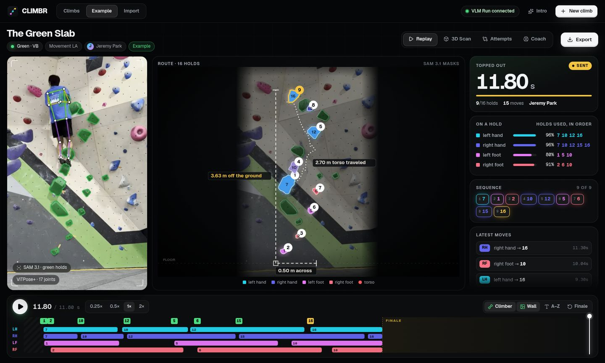
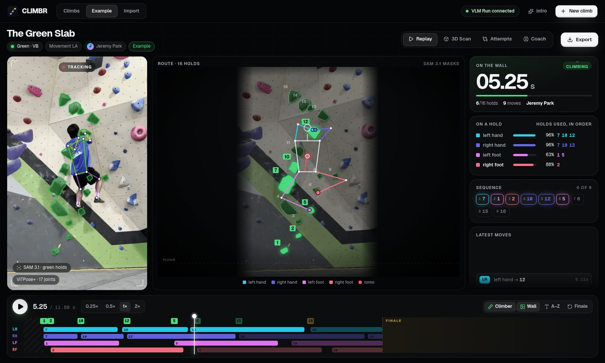
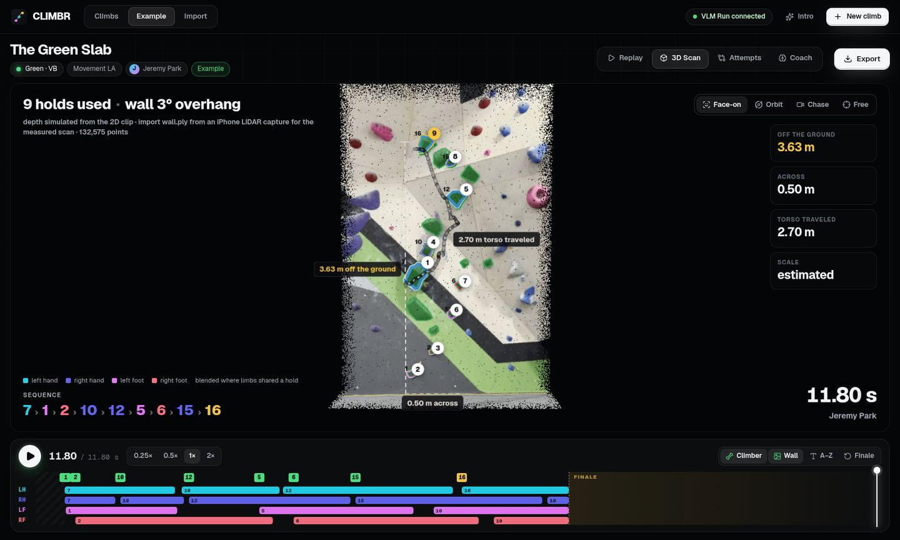
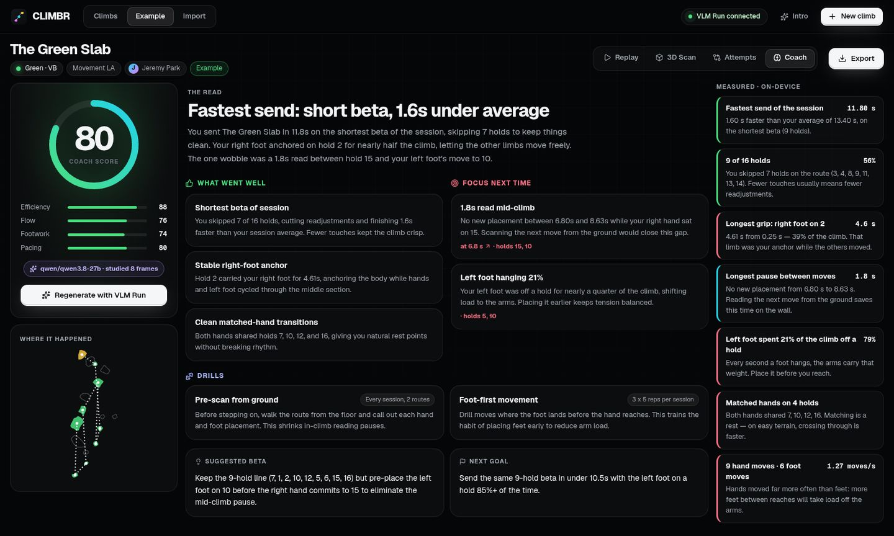
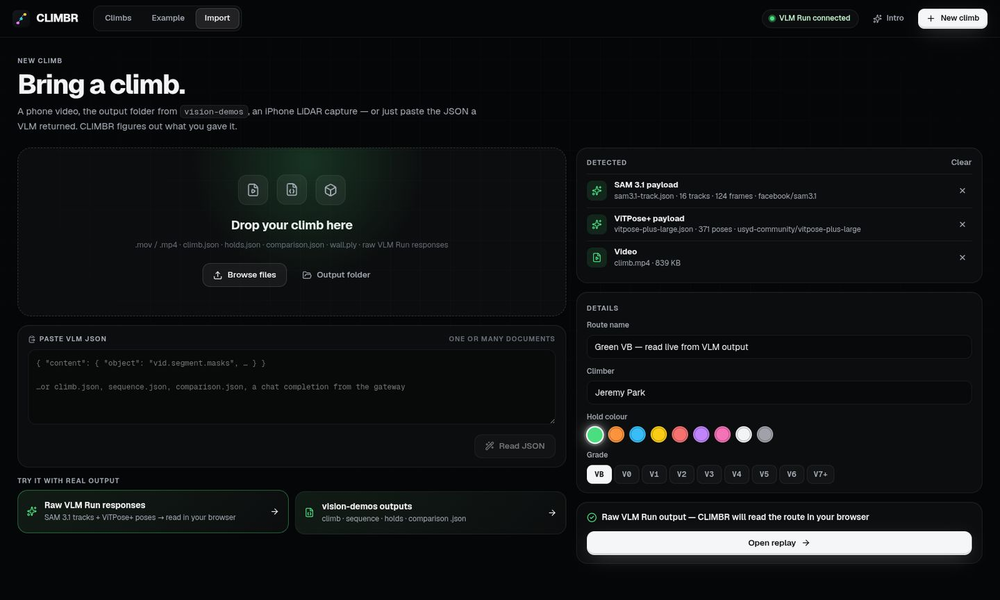

# CLIMBR — read every move

CLIMBR turns a phone video of a boulder problem, or an iPhone LiDAR capture, into a synced replay, a 3D wall measured in meters, and a coach's notes. It segments every hold on your route with **SAM 3.1**, tracks all four limbs with **ViTPose+**, and asks a vision-language model for feedback. All three models run through the [VLM Run](https://vlm.run) gateway.

<p align="center"></p>

## Run it

```bash
npm install
cp .env.example .env        # paste your key after VLMRUN_API_KEY=
npm run dev                 # web on http://localhost:5173, API on :8787
```

The first visit plays the onboarding. Click **Intro** in the top bar to see it again.

Without a key, everything except live analysis and the VLM coach still works: the example, imports, pasted JSON, the 3D view, the on-device coach and every export.

For production, run `npm run build && npm start`. That serves `dist/` and the API from one process on port 8787.

## Deploy to Vercel

1. Import the repo at [vercel.com/new](https://vercel.com/new). `vercel.json` already sets the Vite build and the `api/` functions, so keep the defaults.
2. **Settings → Environment Variables:** add `VLMRUN_API_KEY`.
3. **For live video analysis:** go to **Storage → Create → Blob** and connect the store to the project. That adds `BLOB_READ_WRITE_TOKEN`. Clips are bigger than a function's 4.5 MB request limit, so the browser uploads them to Blob, `api/analyze` reads them from there, and deletes them when done.
4. Redeploy.

Without Blob, everything else still works: the example, imports, pasted JSON, the 3D view, the VLM coach and exports. The Import page says what's missing.

The functions bundle `ffmpeg-static`, so clips (including iPhone `.mov`) are transcoded on Vercel exactly as they are locally. `api/analyze` runs up to 300 s, the Hobby maximum; a typical climb takes 20–40 s. The coach cuts its 8 keyframes in the browser, so it needs no ffmpeg at all.

## What's in it

| | |
|---|---|
| **Onboarding** | A cinematic intro. Pick your capture device, watch the real example climb play itself through the route reader, then set your name, grade and favourite hold colour. |
| **Replay** | The clip, the route map and the live stats on one clock. Holds light up as they are used. A climber figure is solved from the four contact points and the tracked torso. You get *on a hold* percentages, each limb's holds in order, and per-limb contact lanes on a scrubbable timeline. |
| **Finale** | Shown after the top-out. First the completion card comparing every attempt (gold = holds only that attempt used). Then the LiDAR-style replay: holds relight one by one in limb colours with order badges, the torso path grows, and the climb is measured, e.g. *3.63 m off the ground*, *0.50 m across*, *2.70 m torso traveled*. |
| **3D Scan** | A point cloud of the wall with the route on it. It is the real `wall.ply` from an iPhone LiDAR capture, or, without one, a stand-in built from the climber-free wall photo with modelled depth (the view says which). It opens with a scan sweep and has face-on, orbit, chase and free cameras. |
| **Attempts** | Time-to-top bars, a beta matrix (the order each hold was reached, per attempt) and a route map of each attempt's line. |
| **Coach** | A VLM reads the measurements plus 8 keyframes of the clip and writes a headline, scores, strengths, focus points (click one to jump the replay to that moment), drills, suggested beta and a next goal. On-device insights sit alongside. |
| **Import** | Drop a video, a whole `vision-demos` output folder, a LiDAR `wall.ply`, or **paste any VLM JSON**, one document or several. CLIMBR recognises each piece by its shape. A video with nothing else can be analyzed live with SAM 3.1 + ViTPose+, with staged progress. |
| **Export** | A PDF coach report, a 1080×1350 share card, a re-importable CLIMBR session JSON, `climb.json` in the pipeline's own format, and a moves CSV. |

Keyboard: <kbd>Space</kbd> play/pause · <kbd>←</kbd>/<kbd>→</kbd> seek (hold <kbd>Shift</kbd> for 2 s) · <kbd>1</kbd>–<kbd>4</kbd> views · <kbd>E</kbd> export.

<p align="center">
  
  
  
  
</p>

## How it works

```
 browser ──────────────────────────────┐        CLIMBR server (server/)         VLM Run gateway
  · replay, 3D, coach, exports         │  POST /api/analyze  ── ffmpeg ──►  facebook/sam3.1          (track "{color} climbing hold")
  · route reader (src/lib/analyze.ts) ◄┼── NDJSON progress + payloads  ──►  vitpose-plus-large       (pose, every frame)
  · wall plate (src/lib/wallplate.ts)  │  POST /api/coach    ── 8 frames ─►  qwen3.8-27b / gemini      (JSON feedback)
 └─────────────────────────────────────┘  the API key never leaves the server
```

- **The route reader** (`src/lib/analyze.ts`) is a TypeScript port of the core of `vision-demos/rock_climbing/src/climb.py`. It runs in the browser, so live runs and pasted gateway JSON go through the same code. Hold polygons come from SAM's tracks, limbs from ViTPose+ wrists and ankles (toe offset included), and contact uses dwell plus hysteresis. Margins are measured in hold heights and body heights. On the example clip it reproduces the pipeline's hold numbering exactly, finds all 9 holds of its sequence, and comes within about 3 points on each limb's *on a hold* share.
- **The wall plate** is the climber-free photo of the wall. It is a median over a dozen frames, with the climber masked out using the torso track. The route backdrop and the 3D cloud are both coloured from it.
- **The coach** works through a model chain: `CLIMBR_COACH_MODEL`, then `google/gemini-3.7-flash`, `qwen/qwen3.8-27b`, `qwen/qwen3.5-0.8b`. A model the account isn't entitled to is skipped, and the one that answers is remembered. Qwen's thinking mode is switched off so it spends its budget on the answer. The clip goes in as 8 keyframes rather than a `video_url`, because not every chat model on the gateway decodes video.

Measured on the example (12 s clip): SAM 3.1 + ViTPose+ took ~21 s and **$0.036**. The coach took ~7 s and **$0.003**.

## Data it reads

| You give it | It reads |
|---|---|
| `climb.json`, `sequence.json`, `holds.json`, `comparison.json`, `run.json` | [`vision-demos/rock_climbing`](https://github.com/jeremyipark/vision-demos/tree/main/rock_climbing) outputs |
| `wall.ply` + `holds.json` with `depth` | [`rock_climbing_3d`](https://github.com/jeremyipark/vision-demos/tree/main/rock_climbing_3d) iPhone LiDAR outputs (meters, +y up) |
| `{"content": {"object": "vid.segment.masks" …}}` | a raw SAM 3.1 track response |
| `{"content": {"object": "vid.pose.kpts" …}}` | a raw ViTPose+ response |
| `{"choices": [{"message": {"content": "…"}}]}` | any of the above, still wrapped in a chat completion |
| `*.climbr.json` | a session exported from CLIMBR |
| `.mov` / `.mp4` / `.webm` | the clip: replayed in sync, or analyzed live |

The bundled example lives in `public/examples/green-vb/`. Its `gateway/` folder holds the real SAM 3.1 and ViTPose+ responses for the clip. On the Import page, *Try it with real output* loads them.

## Project layout

```
server/core.mjs    the API itself: VLM Run client, transcode, SAM 3.1 + ViTPose+, coach
server/index.mjs   Express wrapper for local runs and `npm start`
api/               the same core as Vercel functions (health, analyze, upload, coach)
src/lib/           session model, route reader, timeline + climber IK, 3D cloud, coach, exports, storage
src/components/    route panel (SVG), video stage, timeline, live stats, 3D scan (react-three-fiber), export sheet
src/views/         onboarding, home, session (replay · 3D · attempts · coach), import
public/examples/   the example climb: pipeline JSON, raw gateway JSON, clip, wall plate, coach feedback
```

## Credits

The example footage, its hold and contact data, and the reference pipeline the route reader is ported from come from [**jeremyipark/vision-demos**](https://github.com/jeremyipark/vision-demos) by Jeremy Park, Apache-2.0. The 3D view's look follows that project's iPhone LiDAR demo.
